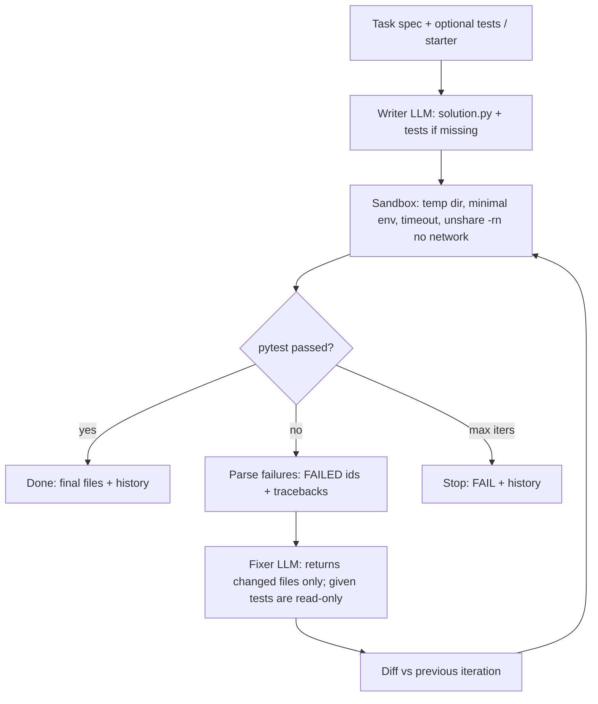

# Self-Correcting Code Assistant

Give it a task spec (and optionally pytest tests). The agent writes `solution.py` (plus its own tests if none were given), runs pytest in a **sandbox**, reads the failures, patches the code, and repeats until the tests pass or `--max-iters` is reached. Every iteration's diff and test output is kept.

## Setup
```bash
cd ./self-correcting-coder
python3 -m venv .venv && .venv/bin/pip install -r requirements.txt
```
LLM: Grok CLI headless (default when `OPENAI_API_KEY` is unset; uses the logged-in SuperGrok account), or any OpenAI-compatible API via `OPENAI_BASE_URL` (default `https://api.x.ai/v1`), `OPENAI_API_KEY`, `MODEL`. Force with `LLM_PROVIDER` / `--provider`.

## Usage
```bash
.venv/bin/python -m coder.cli examples/duration_fail_first.json        # trace with diffs
.venv/bin/python -m coder.cli --spec "Write is_prime(n)..." --brief    # JSON summary
.venv/bin/python -m coder.cli examples/slugify.json --out out/slugify  # save final files
.venv/bin/streamlit run app.py
.venv/bin/pytest -q    # offline, mocked LLM
```
Examples: `roman_numerals` (given tests), `slugify` (agent writes its own tests), `duration_fail_first` (starts from deliberately buggy starter code, so iteration 0 always fails).

## Architecture


## Safety / sandbox
- Code runs in a fresh temp directory with `HOME` pointed there and a minimal `PATH`.
- Hard timeout per run (default 60 s).
- No network: wrapped in `unshare -rn` (new user and net namespace) when the kernel allows it; reported per run as `sandbox: netns+tmpdir` or `tmpdir`.
- User-provided tests are locked: any attempt by the model to rewrite them is discarded.
- Not a full security boundary (same user, same filesystem view); don't run untrusted tasks on sensitive machines.


## Scope & Verification

- **Automated Tests**: `19 passed` via `pytest -q` covering sandbox execution, timeout enforcement, iterative repair loops, and CLI trace output with mocked LLM responses.
- **Scope**: Subprocess sandbox enforces timeouts and temporary working directories for local development tasks; it is not an OS-level security boundary for untrusted code.
